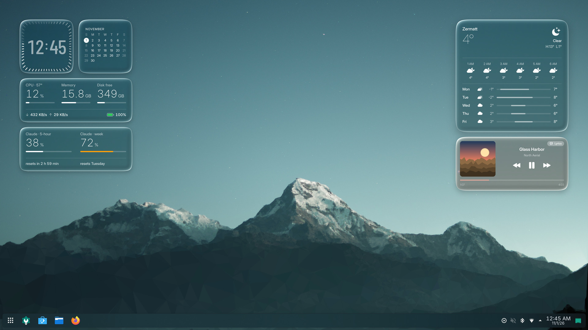
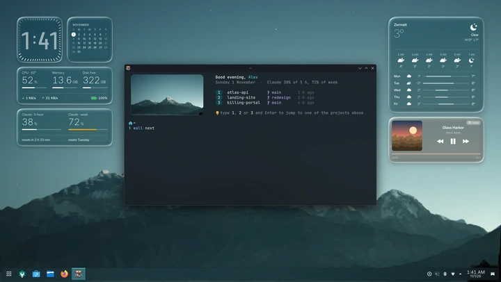
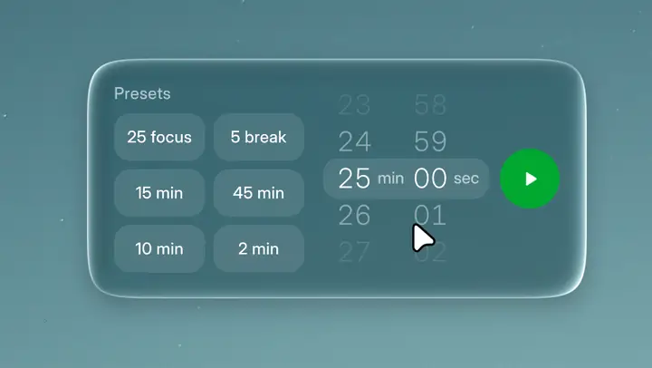
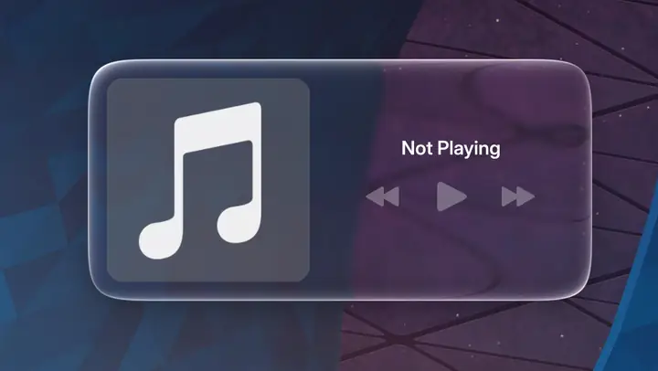
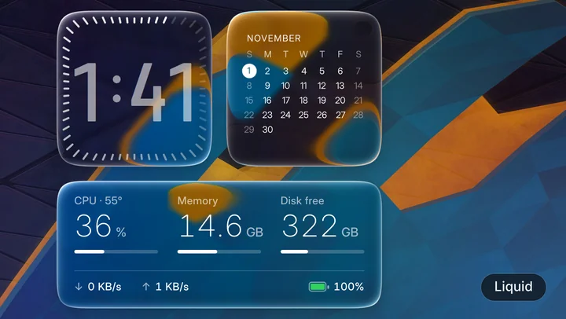
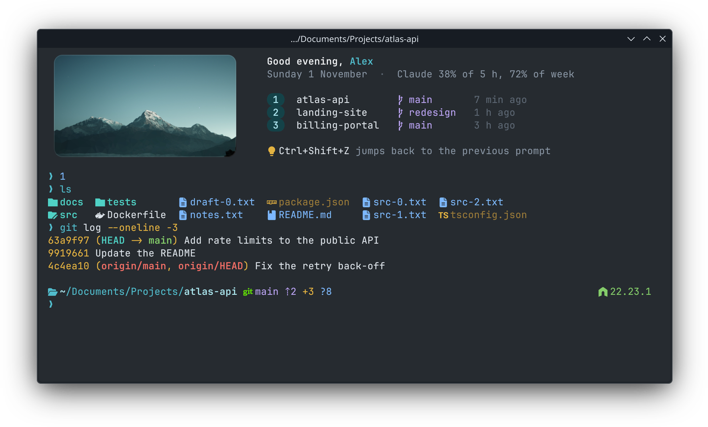
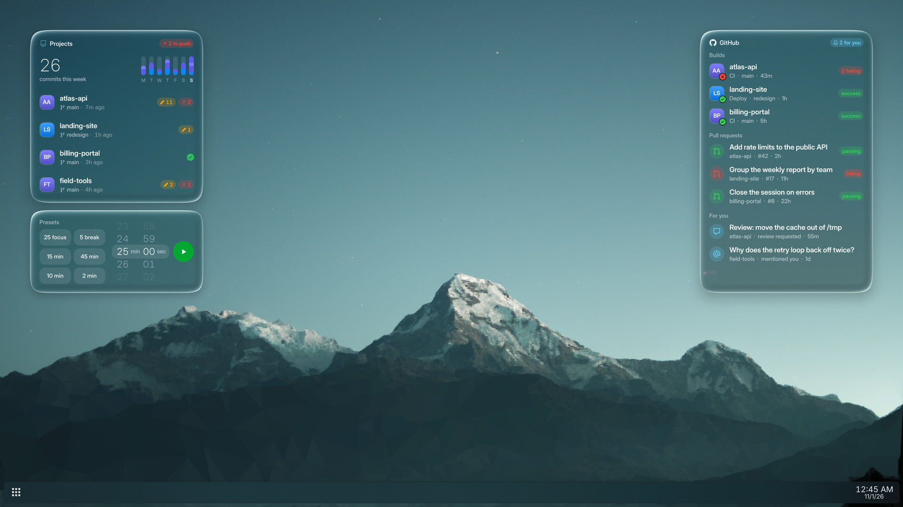

# Summit desktop

A fast, glassy KDE Plasma 6 desktop and terminal setup for Fedora. Everything is user-level (no root),
re-runnable, and measured: a new terminal shows its prompt in about 5 ms.

[Install](#install-the-whole-setup) · [Just the pieces](#just-the-pieces) · [Undo](#undo) · [Releases](https://github.com/VicegerentPrince/summit-desktop/releases)



| Colour follows the wallpaper | Press Play and the wheels melt into a ring |
|:--:|:--:|
|  |  |
| **Music goes quiet when nothing plays** | **Clear Liquid or soft Frosted, your choice** |
|  |  |

Full videos, 16 to 32 seconds at 60 fps (mp4 downloads of 2 to 6 MB, GitHub doesn't play them on the page): [tour](https://github.com/VicegerentPrince/summit-desktop/releases/download/v1.2.0/summit-tour.mp4), [timer](https://github.com/VicegerentPrince/summit-desktop/releases/download/v1.2.0/summit-timer.mp4), [music](https://github.com/VicegerentPrince/summit-desktop/releases/download/v1.2.0/summit-music.mp4), [cards](https://github.com/VicegerentPrince/summit-desktop/releases/download/v1.2.0/summit-cards.mp4), [settings](https://github.com/VicegerentPrince/summit-desktop/releases/download/v1.2.0/summit-settings.mp4).

| The terminal | The second screen |
|:--:|:--:|
|  |  |

## What you get

**Desktop**
- Glass cards, each with its own settings pages. From [Liquid Glass](https://github.com/jaxparrow07/liquidglass-kde-widgets), with
  fixes and new features (see below):
  - **Clock**: 12 or 24 hours in Soft, Clear or Thin digits; only the digits that change lift over;
  - **Calendar** and **Weather**;
  - **Music**: the full player with timeline and lyrics while there is a song, and a quiet card
    when there is none (your choice in its settings);
  - **Timer**: scroll the wheels and press Play, or tap a preset to start at once. The wheels melt into
    a ring or a bar. It runs from one number, so Cancel takes it back from wherever it is.
- New cards in the same glass:
  - **Vitals**: you pick the three figures from CPU, GPU, memory, swap and free disk, with network,
    temperatures and battery below. A graphics card that is asleep reads Off: the card never wakes it;
  - **Claude Usage**: your Claude Code 5-hour and weekly limits, with warnings at the levels you
    choose (needs the status line below);
  - **Projects**: the git projects you worked in last, with uncommitted changes and commits not
    pushed yet; click for a terminal there, or open it in your editor;
  - **GitHub**: builds of the repositories you pushed to last, your open pull requests with their
    checks, and the notifications that are about you (uses your `gh` login; works offline from
    cache). Links open in the Google Chrome profile that matches your GitHub email, or the one you pick;
  - **Wallpapers** (panel): a gallery of your library plus a *Discover* tab that keeps loading
    top-rated photos from Wallhaven at your screen's resolution (4K minimum). Scroll on the icon to
    cycle wallpapers, middle-click for a random one.
- **Motion only when something changes.** Numbers, titles and icons have small transitions, and a
  card at rest costs nothing. They follow Plasma's animation speed, so turning animations off in
  System Settings turns them off here.
- **Accent colour follows the wallpaper.** Each switch picks a colour from the photo (OKLab k-means,
  scored like Material You, checked for WCAG contrast against the interface) and applies it to
  Plasma, to kitty, to the zsh prompt (arrow, folder, command names) and to the welcome card. Open
  terminals pick it up at their next prompt.
- **Liquid Glass, Apple-style**: every card is a thick glass slab. The rim is a clear lens that bends
  the wallpaper, the middle is frosted and keeps its colour, light catches the top-left and
  bottom-right edges, and a soft shadow lifts the card. The tint deepens only over bright
  wallpapers, so white text stays readable. It costs nothing at rest (measured). Each card's
  Appearance page switches between clear Liquid and soft Frosted, with sliders and a button that
  applies the look to every card.
- **Summit Glass** Plasma style: the stock style with a see-through, blurred panel.
- **Second screen.** Plug in a monitor and it becomes the main screen with the full panel and the
  widgets; the laptop gets a matching panel with the launcher, the windows on that screen and a
  clock, and its own work set: Projects, GitHub and the focus timer. Unplug and the laptop has the full desktop again, nothing to re-run. HDMI monitors that
  accept it get full-range colour instead of the TV range Plasma picks by default
  (`screens/black-level.png` shows the difference).
- Summit colour scheme (slate graphite, teal), Papirus icons with teal folders, Bibata cursor, Inter
  and JetBrains Mono.

**Terminal** ([kitty](https://sw.kovidgoyal.net/kitty/) + zsh)
- Welcome card in each new window: the current wallpaper, a greeting, your three most recent
  projects (type `1`, `2` or `3` to jump there) and a tip. Pure zsh, about 2 ms.
- Powerlevel10k with instant and transient prompt, fuzzy Tab completion with previews (fzf-tab),
  atuin history on `Ctrl+R`, zoxide `cd`, autosuggestions and syntax highlighting.
- Tabs with per-program icons, rounded split panes, instant "did you mean" for typos.
- Summit themes for bat, delta (`git diff`), lazygit, yazi, btop, tmux, eza, nano, fastfetch,
  tldr, glow, fzf, Neovim, KWrite/Kate, and a **Summit theme for VS Code and Cursor**.
- Type `keys` for a one-page reference of every shortcut.

**Speed work you get for free** (each measured on the original machine)
- Fedora's command-not-found handler (about 4 s per typo) replaced by an instant one.
- `/etc/profile.d` is not re-run for every terminal (about 150 ms).
- atuin writes through its daemon (6 ms instead of up to 80 ms per command).
- mise's per-prompt check stays on its fast path (2 ms instead of 10 ms).

## Just the pieces

Each of these works without the rest of the setup. Download it from the
[latest release](https://github.com/VicegerentPrince/summit-desktop/releases/latest), then:

| | file | how |
|---|---|---|
| **Vitals**, **Claude Usage**, **Projects**, **GitHub**, **Wallpapers** | `summit-vitals-1.2.0.plasmoid` and so on | `kpackagetool6 -t Plasma/Applet -i <file>` (`-u` to upgrade), then right-click the desktop › Add Widgets. Wallpapers goes on your panel. |
| **Summit** colour scheme | `Summit.colors` | System Settings › Colours › Install from File |
| **Summit Glass** Plasma style | `summit-glass-1.2.0.tar.gz` | System Settings › Plasma Style › Install from File |

The release also carries the Clock, Calendar, Weather, Music and Timer cards with Summit's changes
(`summit-timer-1.2.0.plasmoid` and so on). They keep Jack Faith's widget ids, so each one replaces his
version of that card.

[Summit Vitals](https://store.kde.org/p/2377656) and the [whole desktop](https://store.kde.org/p/2377643)
are also on the KDE Store. `store/build.sh` builds every file above from a clone.

## Install the whole setup

Fedora 44, KDE Plasma 6.7, Wayland. Other distributions should work with their own package names,
but have not been tested.

```sh
# packages (the only step that needs root)
sudo dnf install -y zsh git gh curl fzf bat eza zoxide btop tmux nano neovim fastfetch \
  zsh-autosuggestions zsh-syntax-highlighting python3-pillow jq \
  papirus-icon-theme bibata-cursor-themes rsms-inter-fonts jetbrains-mono-fonts kitty-terminfo

git clone https://github.com/VicegerentPrince/summit-desktop ~/.local/share/summit-desktop
cd ~/.local/share/summit-desktop
./install.sh --layout                        # --layout places the desktop widgets
wall fetch -n 12                             # a first batch of wallpapers
chsh -s /usr/bin/zsh                         # optional: zsh as your login shell
```

Then log out and back in once.

- **Weather location:** `SUMMIT_WEATHER="Berlin:52.52:13.405" ./install.sh --layout`, or in the card's settings.
- **Claude usage widget:** add the status line to `~/.claude/settings.json`:
  `"statusLine": { "type": "command", "command": "~/.claude/statusline.sh", "padding": 0 }`
- **GitHub card:** run `gh auth login` once.
- **Wallpapers widget:** right-click your panel › Add Widgets › Summit Wallpapers.
- **Projects card and welcome card** read `~/Documents/Projects`. The card's settings take other
  folders; `welcome off` hides the welcome card.

Every file the installer would overwrite is first copied to `~/.local/state/summit/backup-<time>/`.
`./install.sh` is safe to run again; it changes nothing that is already right.

`--layout` also starts a small watcher, so the cards stay in place on a new monitor or scale. It
sleeps until a screen changes and leaves anything you arranged by hand alone.
`systemctl --user disable --now summit-layout.service` turns it off. Without `--layout` it is never
installed, and the cards stay where you put them.

## Undo

1. Stop the background service: `systemctl --user disable --now summit-monitor-power.service`.
   If you installed with `--layout`, stop the watcher too: `systemctl --user disable --now summit-layout.service`.
2. Right-click each card › Remove, then delete the widgets:
   `rm -rf ~/.local/share/plasma/plasmoids/{summit.*,com.jaxparrow07.macoswidgets.{clock-square,calendar,weather,music,timer}}`
3. In System Settings, pick your Colours, Plasma Style, Icons, Cursors and Fonts again. The panels and the
   wallpaper stay as they are until you change them.
4. If the installer replaced any of your files, put them back from the oldest backup:
   `cp -r ~/.local/state/summit/backup-<time>/. ~/`. If you changed your login shell, `chsh -s /bin/bash`.

## Commands

| command | what it does |
|---|---|
| `wall next` / `prev` / `random` | switch wallpaper (desktop, lock screen, accent, welcome card) |
| `wall fetch -n 8 aurora` | download more photos from Wallhaven |
| `wall accent on` / `off` | let the accent follow the wallpaper, or put your scheme's own back |
| `wall accent` | re-pick the accent after changing the wallpaper some other way |
| `welcome` | show the welcome card again |
| `keys` | every shortcut on one page |
| `y`, `lg`, `lzd` | file manager, git, docker |

## Layout

| folder | what |
|---|---|
| `install.sh`, `fetch.sh` | installer and downloads (kitty, zsh plugins, mise tools, Liquid Glass) |
| `home/` | dotfiles, installed to the same paths under `~` |
| `look/` | colour scheme, icons, cursor, fonts |
| `plasma-style/` | the Summit Glass panel |
| `screens/` | the second-screen panel, full RGB range for HDMI monitors, the laptop taking over when the monitor loses power (needs `ddcutil`), a black-level test image |
| `widgets/`, `widgets-panel/` | the widgets (`assemble.sh` builds them), the changes to Liquid Glass (`liquid/`, `liquidglass.sh`) and the layout (`layout.js`, `layout-watch.sh`) |
| `store/` | `build.sh` for the KDE Store files, the listings (`STORE.md`) and their images |
| `tools/`, `syntax/` | themes for the CLI tools and editors |
| `vscode/` | the VS Code / Cursor theme and the scripts that build and check it |
| `extras/` | optional, hardware-specific fixes (a WirePlumber rule for the Redragon GM303 microphone) |

## Changes to Liquid Glass

Applied at install time to a pinned upstream commit (`widgets/liquidglass.sh`, `patch_glass.py`,
`widgets/liquid/`):
the clock redraws once a second instead of 60 times (it used 23% of a CPU core); the music widget
updates once a second, fetches lyrics only when shown, and its play/pause works with KDE Connect
players; the glass no longer turns black after a shell restart or goes stale when the wallpaper
changes; a few QML warnings fixed; Inter replaces the bundled Apple fonts; the "no album"
placeholder takes the glass colour; the timer's presets are the ones a working day uses (25 min
focus, 5 min break, ...) and a finished timer flashes for eight seconds, not forever. The glass
shader is replaced by Summit's (`widgets/glass/`: lens rim, vibrancy, adaptive tint, Fresnel rim,
rim light, edge light and a drop shadow), built on Jack Faith's pipeline.

New in `widgets/liquid/`: the Timer's Wheels, Ring and Bar faces and the liquid start between them
(its own shader, with presets you can edit); the Clock's digit styles and 12 or 24 hours; Music's
quiet card and the slide when a song changes; transitions on the Weather and Calendar cards; a
rebuilt Appearance page. Each card's credits name both authors.

## Credits and licence

- Glyphs on the Projects and GitHub cards: [Octicons](https://github.com/primer/octicons) by GitHub Inc., MIT License (`widgets/parts/OCTICONS-LICENSE`).
- **Liquid Glass** by Jack Faith ([jaxparrow07](https://github.com/jaxparrow07/liquidglass-kde-widgets)), GPL-3.0:
  the clock, calendar, weather and music widgets, and the glass effect that Vitals and Claude
  Usage are drawn with. His widgets are also on the [KDE Store](https://store.kde.org/u/jaxparrow07).
  If you like the look, support him on [Ko-fi](https://ko-fi.com/devrinth).
- **Inter Display** (bundled with the glass widgets, `widgets/common/fonts`) by The Inter Project
  Authors (Rasmus Andersson), SIL Open Font License 1.1.
- Wallpapers are not included; `wall` downloads them from [Wallhaven](https://wallhaven.cc), where
  each photo belongs to its author. The screenshots and videos use wallpapers that ship with KDE
  Plasma: *Mountain* by Andy Betts, *Honeywave* by Ken Vermette and *Scarlet Tree* by axo1otl, all
  CC BY-SA 4.0, and the pictures that show them stay under that licence.
- Breeze (the base of Summit Glass) by the KDE Visual Design Group, LGPL; Summit Glass keeps that licence.

This project is released under the GNU General Public License v3.0, see [LICENSE](LICENSE), except
Summit Glass (LGPL, from Breeze) and the Inter fonts (OFL).
